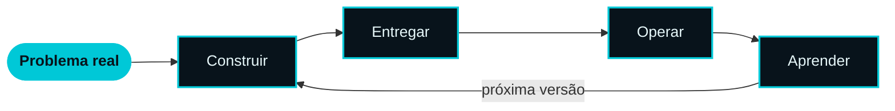

  

**Construímos o software que mantém operações reais funcionando.** 
A complexidade fica com o sistema. Nunca com quem usa.

 

&nbsp;

&nbsp;

 

---

 

  

### O ecossistema que coloca o condomínio sob controle.

Gestão, controle de acesso e experiência mobile em uma única plataforma, 
desenvolvida e evoluída continuamente pela Controle Tecnologia.

 

<table>
<tr>
<td align="center" width="25%">
 
<b>Gestão</b> 
Operação centralizada, do cadastro à rotina.
  
</td>
<td align="center" width="25%">
 
<b>Acesso</b> 
Tecnologia aplicada à porta de entrada.
  
</td>
<td align="center" width="25%">
 
<b>Mobile</b> 
Tudo na mão de quem precisa, onde estiver.
  
</td>
<td align="center" width="25%">
 
<b>Integração</b> 
Sistemas e equipamentos trabalhando juntos.
  
</td>
</tr>
</table>

 

 

---

 

## O que construímos

<table>
<tr>
<td width="50%" valign="top">

### Produtos digitais
Plataformas próprias pensadas para durar anos, não para fechar um escopo.

`PLATAFORMAS` `PRODUTO` `UX`

</td>
<td width="50%" valign="top">

### Aplicações
Interfaces web e mobile que transformam operações complexas em poucos toques.

`WEB` `MOBILE` `INTERFACES`

</td>
</tr>
<tr>
<td width="50%" valign="top">

### Integrações
APIs e serviços que fazem sistemas, equipamentos e parceiros funcionarem como um só.

`APIs` `SERVIÇOS` `CONECTORES`

</td>
<td width="50%" valign="top">

### Automação
Tarefas manuais e repetitivas viram fluxos rápidos, previsíveis e rastreáveis.

`FLUXOS` `PROCESSOS` `EFICIÊNCIA`

</td>
</tr>
</table>

 

## Como pensamos

<table>
<tr>
<td width="25%" valign="top" align="center">

<h1>01</h1>

**Simples por fora**

A complexidade é responsabilidade do sistema, nunca do usuário.

</td>
<td width="25%" valign="top" align="center">

<h1>02</h1>

**Sólido por dentro**

Feito para a rotina de produção, não para a demonstração.

</td>
<td width="25%" valign="top" align="center">

<h1>03</h1>

**Pronto para conectar**

Nenhum produto vive sozinho. Integração é requisito desde o início.

</td>
<td width="25%" valign="top" align="center">

<h1>04</h1>

**Sempre evoluindo**

O lançamento é a primeira versão. O uso real define a próxima.

</td>
</tr>
</table>

 

## O ciclo

 

 

---

 

  

## Controle Tecnologia

**Tudo sob controle.**

 

`PRODUTOS` &nbsp;•&nbsp; `APLICAÇÕES` &nbsp;•&nbsp; `INTEGRAÇÕES` &nbsp;•&nbsp; `AUTOMAÇÃO`

  

  

Desenvolvido no Brasil 🇧🇷

